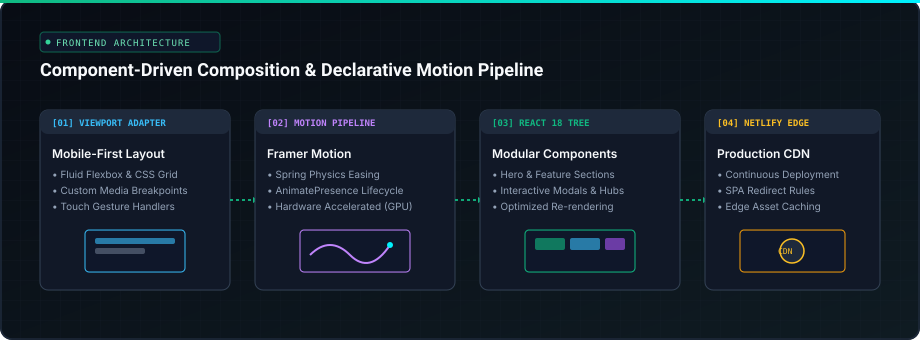

# VirtualEnvi — Interactive Experience Platform

A mobile-first, responsive web application engineered with React.js, modern CSS3, and fluid declarative animations powered by Framer Motion.

[](https://virtualenvi.netlify.app)
[](https://reactjs.org/)
[](https://www.framer.com/motion/)
[](https://www.netlify.com/)

---

## 🌐 Live Application

Explore the deployed platform: **[virtualenvi.netlify.app](https://virtualenvi.netlify.app)**

---

## ✨ Features & Architecture

<p align="center">
  
</p>

- **Mobile-First Responsive Layout:** Custom media queries and flexible grid layouts tailored for optimal viewports across phones, tablets, and desktop displays.
- **Declarative Animation Pipelines:** Utilizes Framer Motion components (`motion.div`, variants, and gesture controls) for high-performance physics-based micro-interactions.
- **Component-Driven Composition:** Structured UI components separating layout containers, dynamic modal dialogs, and reusable presentation blocks.
- **Automated Deployment:** Configured with `netlify.toml` for continuous deployment and single-page application (SPA) client-side routing redirects.

---

## 🛠️ Tech Stack

- **Core Framework:** React.js (Create React App baseline)
- **Animation Engine:** Framer Motion
- **Styling:** CSS3, Modular CSS transitions, Flexbox & Grid
- **Build & Package Management:** npm
- **Hosting & CI/CD:** Netlify

---

## 🚀 Getting Started

### Prerequisites

- Node.js (v16.x or higher recommended)
- npm or yarn

### Installation & Local Setup

1. **Clone the repository:**
   ```bash
   git clone https://github.com/dimrishashank/virtualenvi.git
   cd virtualenvi
   ```

2. **Configure environment variables:**
   ```bash
   cp .env.example .env
   ```

3. **Install dependencies:**
   ```bash
   npm install
   ```

4. **Run the development server:**
   ```bash
   npm start
   ```

The application will be accessible at `http://localhost:3000`.

### Building for Production

To create an optimized production build:

```bash
npm run build
```

The output bundle is generated inside the `build/` directory, pre-configured for static host distribution.

---

## 📄 License

This project is licensed under the MIT License.
